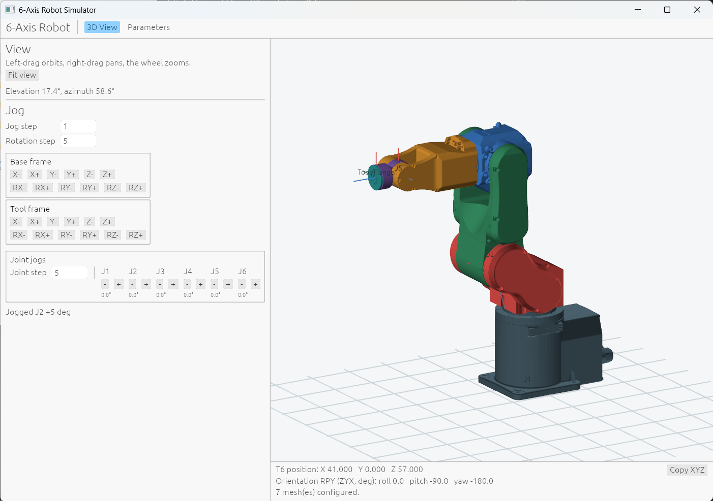

# Preface

AI coding challange is in verification and correctness.
The entire point is to spend less human time, but still come out with functional program. 
The approach used here is to rely on Lean specification to ensure the underlying math of robot motion is correct.
The Lean code itself is also AI coded, but it's proved correct mathematics. 
Trying this was the primary motiovation of the project.

The final consideration is cost.
This project here at current state has spent $10.24USD of Deepseek tokens, very economical in my estimate.
It doesn't have to be a frontier model when validations and testing are good enough to guide a cheaper model.

# Six-axis robot arm simulator

A desktop application that simulates a 6-axis articulated robot arm. It draws the
arm as a chain of Denavit–Hartenberg frames in an interactive 3D view, can overlay
an STL mesh on the base and on each joint, and moves the arm either joint by joint
or by jogging the end effector in Cartesian space. Cartesian and rotation jogs are
solved with a closed-form inverse kinematics derived for this arm's structure.

The mathematics behind it is written out in [`mathematics.md`](docs/mathematics.md) and
proved in Lean under [`lean/`](lean) — see [Mathematics](#mathematics) below.

The application is the **Rust** one under [`crates/`](crates): it has a GPU renderer,
a kinematics core built for a real-time control loop, and a force/torque sensor model.
The original Python Tkinter viewport has been retired; `kinematics.py` remains as the
closed-form oracle the Rust compatibility layer is tested against, together with the
Python suites that check it.



## Run

### Rust

```powershell
cargo run -p robot-app --release
```

## Using the simulator

### 3D View tab

The view draws the base and all six joint frames as xyz axis markers at their
frame origins, plus a scale-adaptive XY reference grid on the Z=0 plane. Drag
with the left mouse button to orbit, drag with the right mouse button to pan,
and use the scroll wheel to zoom. The view starts in an isometric orthographic
angle.

The front readout shows the current T6 pose — the end effector's position and
orientation. **Copy XYZ** puts the T6 position, its orientation as ZYX
roll/pitch/yaw, and all six runtime joint angles on the clipboard at full
precision. A joint that has wound a full turn or more, in either direction,
carries its turn index in the copied text as well — a J6 held at 400° copies as
`J6: 400  (index 1 + 40°)` — while a joint inside ±360° copies exactly as
before.

### Parameters tab

Two sub-tabs, **DH Parameters** and **Meshes**.

**DH Parameters.** DH values are editable per joint. Angles are entered in
degrees, while `d`, `a`, and mesh offsets use consistent model units. The DH
table separates each joint's static theta offset from its runtime joint angle.
Runtime angles start at zero each time the application launches and are not
folded back into a single turn; **Apply to View** uses offset plus runtime
angle for forward kinematics. Saving stores only the static theta offset and
link dimensions, never the runtime joint position. Solves run on the runtime
angles at full precision; the joint angle fields and the front readouts render
them rounded, and a field left untouched keeps its exact value when an edit
elsewhere is applied. Older configuration files using `theta_deg` are read as
static offsets.

Independent coordinate-gizmo visibility checkboxes cover the base and J1–J6. All
are visible by default, and their states are stored in `show_coordinate_gizmos`
in `robot_parameters.json`. Joint labels have a separate show/hide checkbox,
defaulting to visible.

**Meshes.** Each of the base and the six joints can load an STL mesh. A mesh has
a local XYZ offset from its zero marker and local X/Y/Z Euler rotations applied
in that order, in degrees. Opacity ranges from 0 (transparent) to 1 (opaque).
Use **Show triangle edges** to toggle mesh outlines; it is off by default. Apply
changes to update the view.

**Save JSON** and **Load JSON** persist all DH and mesh settings in
`robot_parameters.json`; mesh paths are stored relative to the configuration
file when possible. The included DH values are illustrative starter dimensions
that match the shipped `robot_parameters.json`, not measurements for a specific
robot.

### Jogging

The 3D View groups its jog controls into a **Base frame** group, a **Tool
frame** group, and a **Joint jogs** group, with one shared jog step in model
units and one shared rotation step in degrees.

**Base frame** and **Tool frame** each carry X/Y/Z buttons that offset the
current T6 position along that frame's axes and RX/RY/RZ buttons that turn T6
about them. Base-frame moves run along the base axes, while tool-frame moves run
along the axes frame 6 carries, which is what you want when advancing along the
tool's own approach direction. Rotation jogs keep the T6 origin fixed and apply
the requested rotation about the axes of whichever group the button belongs to,
base or tool.

Every pose jog, base frame or tool frame, solves the new pose with its full
orientation fixed. If inverse kinematics cannot satisfy both the requested
position and orientation, the jog is rejected and the robot remains at its
current pose; it does not silently rotate the end effector.

**Joint jogs.** Individual joints can also be jogged directly, with `J1`–`J6`
minus/plus buttons and a configurable joint-angle step. The displayed runtime
angles stay synchronized with the Joint Angle fields in the Parameters tab;
applying angle edits there also refreshes the front-screen readouts.

A joint jog adds its step to the stored runtime angle and leaves the result
unwrapped, so repeated jogs in one direction can carry a joint past a full
turn instead of folding it back; J6 can sit at 400°, a whole turn further round
than the 40° a solver reports for that joint. Once a joint has wound a full
turn or more, in either direction, the front readout annotates the angle with
the turns it carries — `400.0°  idx 1` — and **Copy XYZ** names the same turns
in the clipboard text; a joint inside ±360° reads exactly as it does in the
Python. A pose jog keeps that winding: the solved configuration is placed
beside the angles the arm is holding, so a jog from a wound joint implies at
most a half turn of motion rather than a whole turn back to its wrapped angle.

## Inverse kinematics

Cartesian and rotation jogs solve the full pose with closed-form inverse
kinematics, which is derived for this robot's structure: `alpha` of 90, 0, 90,
90, -90, 0 degrees, `a3 = a4 = a5 = a6 = 0`, `d2 = d3 = d5 = 0`, and positive
`a2` and `d4`. A DH table that departs from that structure is still drawn and
can still be jogged joint by joint, but a pose jog reports which parameter is
unsupported in the status line instead of moving the robot.

The derivation is in the *Inverse kinematics* section of
[`mathematics.md`](docs/mathematics.md).

## Repository layout

| Path | Contents |
| --- | --- |
| `crates/robot-kinematics` | DH transforms, forward kinematics, closed-form inverse kinematics |
| `crates/robot-dynamics` | Wrench frame algebra, gravity and inertia compensation |
| `crates/robot-model` | Parameter types and `robot_parameters.json` persistence |
| `crates/robot-app` | Bevy + egui desktop application |
| `crates/robot-golden` | Exact rational arithmetic and the Lean numeral format, for tests |
| `xtask` | `cargo xtask gen-golden` / `check-golden` |
| `docs/` | Derivations, verification boundaries, the Lean↔Rust map, and the Rust transition record |
| `kinematics.py` | The original DH transforms and closed-form inverse kinematics, kept as the oracle for the Rust compatibility tests |
| `lean/` | Lean formalisation and proofs of the same mathematics |
| `robot_parameters.json` | Default DH and mesh configuration |
| `mesh/` | Example STL meshes to load into the view |
| `test_data/` | Generated ground truth, produced by the Lean generators |
| `test_kinematics.py`, `test_force_torque.py` | Python test suites |
| `.vscode/extensions/robot-arm-validations` | The Rust, Lean and ground-truth items in VS Code's Test view |

## Mathematics

[`mathematics.md`](docs/mathematics.md) derives everything the simulator computes;
[`lean/`](lean) proves the same results formally, as pure proof libraries with no
robot code of their own.

| Topic | Derivation in `mathematics.md` | Proof in `lean/` |
| --- | --- | --- |
| DH transform, frame chain, joint and tool positions | *Forward Kinematics with Denavit–Hartenberg Parameters* | `Kinematics.lean` |
| Closed-form inverse solver | *Inverse kinematics* | `InverseKinematics.lean`, on `Zyz.lean` and `Atan2.lean` |
| A solved angle's representative and rotation index | *Inverse kinematics* → *Choosing the representative: the rotation index* | `Atan2.lean` |
| Wrench transport between frames | *Force/torque sensor dynamics* → *Frame changes* | `TorqueWrench.lean` |
| Sensor measurement model and compensation | *Force/torque sensor dynamics* | `Dynamics.lean` |

### Kinematics

`lean/Kinematics.lean` covers the Denavit–Hartenberg transform, the cumulative
frames the simulator draws, and the planar reduction.
`lean/InverseKinematics.lean` covers the closed-form solver and proves it sound —
every candidate it returns reproduces the target pose exactly
(`fk_of_mem_solutions`) — and complete: for a commanded configuration outside
three degenerate cases the solver returns that configuration, every angle equal
modulo a full turn (`exists_solution_angles_eq`).
The three exceptions are named exactly rather than approximated: a wrist center
on the base axis, the arm folded back with equal links, and the wrist singularity
`sin θ5 = 0`, where joints 4 and 6 share an axis and only `θ4 ± θ6` is
observable. The numeric position solvers, floating-point tolerances and joint
limits are deliberately out of scope — the specification covers the closed form,
and over the reals the thresholds the code uses become exact predicates.

`lake build` in `lean/` builds all of it, and the derivation it follows is in
[`mathematics.md`](docs/mathematics.md).

### Force/torque control

For force torque control to be possible, 6DOF force sensor readings must be
recalculated from one frame of reference to another — for example from the
sensor frame to the tooltip frame where the contact point actually is. That
static frame algebra is proved in `lean/TorqueWrench.lean`.

The frame transforms alone are not enough for a real robot: the sensor measures
the wrench *transmitted through it*, which also contains the gravitational and
inertial wrench of the tool and payload. Those are modelled in
`lean/Dynamics.lean`, which proves that gravity/inertia compensation recovers the
contact wrench exactly (`recoveredContactWrench_measuredWrench`), that the model
does not depend on which frame it is evaluated in (`inertialWrench_transport`,
`gravityWrench_transport`), and that rigidly attached bodies combine into one
(`inertialWrench_add`). The derivation, with the sign conventions, is in the
*Force/torque sensor dynamics* section of [`mathematics.md`](docs/mathematics.md).

## Tests

`test_kinematics.py` checks the Python closed-form solver that
`crates/robot-kinematics/tests/python_compat.rs` runs as its differential oracle.
`test_force_torque.py` re-derives every number in
`test_data/force_torque_frames.json` (schema 3, including the `dynamics_cases`
section) from the case inputs in exact rational arithmetic.

The Rust suites go further, because they can: the forward chain, the wrench
algebra and the dynamics are polynomials in their inputs, so they evaluate exactly
over the rationals and are checked against the generated vectors with `==` and no
tolerance at all. The forward chain manages this because every `alpha` in the arm's
fixed twist pattern is a quarter turn — cosine `0`, sine `1`, both exact — and
because the chain reads each joint angle only through its cosine and sine, so
supplying those as data makes the whole thing polynomial. The angle-valued parts
cannot be treated this way, since `atan2` and `arccos` are irrational outside a
handful of cases; those are covered by restating the Lean theorems as executable
properties instead. [`docs/verification.md`](docs/verification.md) sets out the
whole boundary, including what is deliberately not attempted.

```powershell
cargo test --workspace          # everything, including the exact comparisons
cargo xtask gen-golden          # regenerate test_data/ from the Lean generators
cargo xtask check-golden        # regenerate and fail if the committed data has drifted
```

`check-golden` takes minutes rather than seconds: the Lean generators re-derive
each case by evaluation before writing anything, and that check sweep dominates.

CI runs three independent jobs: the Python suite, the Rust workspace, and
`lake build` over the Lean libraries in `defaultTargets`. The Lean job also
regenerates the ground truth and fails if it differs from what is committed —
the Rust suites and `test_force_torque.py` both read the committed files and never
regenerate them, so without that step the data could drift from the Lean that
produced it while every suite kept passing on stale numbers.

All of it is also in VS Code's Test view. The workspace extension in
[`.vscode/extensions/robot-arm-validations`](.vscode/extensions/robot-arm-validations)
contributes the Rust tests per package, target and test function, one item per Lean
library in the lakefile, `check-golden`, and the fmt / clippy / `no_std` checks; the
Python suites are there too, from the Python extension. Nothing provides a Test view for
Rust or Lean, which is what the extension is for — install it once from *Workspace
Recommendations* in the Extensions view. Its output parsing runs under plain Node, which
is also how it is tested — the suite stubs the VS Code API the way the host behaves, so
the items it builds are held to the same read-only properties:

```powershell
node --test ".vscode/extensions/robot-arm-validations/test/*.test.js"
```

## Where the Rust deliberately differs from the retired Python app

The Python Tkinter viewport (`simulator.py`) has been removed. The record of the port,
including the line references these notes were written against, is in
[`docs/rust_transition_remarks.md`](docs/rust_transition_remarks.md). Four changes are
intentional rather than oversights, and all are visible.

**Mesh scale.** The Python app applied no scale factor to the STL meshes at all,
so the meshes and the DH table never actually lined up: the shipped meshes are in
millimetres and span hundreds, while the DH dimensions are tens. The Rust applies a
factor of `0.1`, which is what makes a loaded mesh sit on the arm. The shipped
`robot_parameters.json` has every mesh path empty, so nothing loads at startup
until a mesh is chosen.

**Gizmo checkboxes.** In the Python app the labels and the things they toggle are
off by one: the checkbox labelled *J1* toggles the **base** gizmo, *J2* toggles J1,
and so on to *Tool/Flange*, which toggles J6. The render side is right and the
labels are wrong. The Rust labels them to match what they toggle.

**Save and Load ask for a file.** The Python app had no chooser for either: it read
and wrote `Path(__file__).with_name("robot_parameters.json")`, the file beside the
script, and reported through a message box. A compiled binary has no script
directory to anchor that to, so the Rust starts at the same name — beside the
executable, then in the working directory, then beside the executable — and opens
whatever the user picks. `crates/robot-app/build.rs` stages the shipped file there
when it builds, together with the `mesh/` tree its relative mesh paths need, so an
executable run from its own directory opens the real robot rather than the empty
default document; the copies are skipped when the bytes already match, which leaves
a configuration the app itself saved beside the binary alone until the shipped file
changes. The bytes written are unaffected, apart from line endings:
Python's `write_text` is text mode, so it turns the newlines into CRLF on Windows,
while the Rust writes `json.dumps(data, indent=2) + "\n"` as-is. Both read either
form back.

**A pose jog keeps a wound joint's winding.** A solved angle is defined modulo a
full turn, and `kinematics.py` materialises that on the way back to a caller:
it wraps every angle its solver returns (`_wrap_angle(total - joint.theta)`,
`:562`), and the Python app stored the result as it came, through
`_apply_joint_solution`'s `math.degrees`. A joint on the arm carries no such
equivalence: a joint jog accumulates, and J6 can sit at 400°, so the solver's
40° is that same joint a whole turn away — a Cartesian jog from it stores 40°,
spinning the arm a full turn on a one-unit move. The Rust keeps the reference's
selection of the candidate, because a
candidate a whole turn away really is the configuration the arm is holding,
and places the chosen one at the representatives nearest the angles the arm
holds (`robot_kinematics::units::nearest_representative`). The implied motion
is then at most a half turn, and the joint keeps the winding it had, which the
readout names (see [Jogging](#jogging)).
